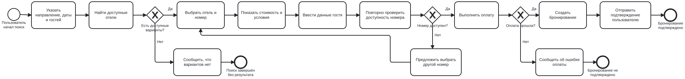

# Бизнес-функция «Бронирование отеля»

## 1. Конкурентный анализ

Для определения основных требований к функции бронирования отеля были рассмотрены возможности аналогичных сервисов: Яндекс Путешествия, Ozon Travel и Суточно.ру.

| Функция                      | Яндекс Путешествия | Ozon Travel | Суточно.ру |
| ---------------------------- | ------------------ | ----------- | ---------- |
| Поиск жилья                  | Да                 | Да          | Да         |
| Выбор дат                    | Да                 | Да          | Да         |
| Выбор количества гостей      | Да                 | Да          | Да         |
| Фильтрация вариантов         | Да                 | Да          | Да         |
| Сортировка                   | Да                 | Да          | Да         |
| Просмотр информации об отеле | Да                 | Да          | Да         |
| Просмотр номеров             | Да                 | Да          | Да         |
| Отзывы и рейтинг             | Да                 | Да          | Да         |
| Бронирование                 | Да                 | Да          | Да         |
| Оплата                       | Да                 | Да          | Да         |
| Управление бронированием     | Да                 | Да          | Да         |
| Избранное                    | Да                 | —           | Да         |

На основании анализа выделен общий сценарий работы пользователя:

1. Пользователь указывает направление поездки.
2. Указывает даты заезда и выезда.
3. Указывает количество гостей.
4. Получает список доступных вариантов.
5. Использует фильтры и сортировку.
6. Выбирает отель.
7. Выбирает подходящий номер.
8. Ознакомляется со стоимостью и условиями проживания.
9. Указывает данные гостя и контактную информацию.
10. Подтверждает и оплачивает бронирование.
11. Получает подтверждение бронирования.

Таким образом, основой разрабатываемой бизнес-функции является возможность пользователя самостоятельно найти подходящий отель и оформить его бронирование через сервис туроператора.

## 2. Глоссарий

| Термин                     | Определение                                                       |
| -------------------------- | ----------------------------------------------------------------- |
| Пользователь               | Клиент сервиса, который ищет и бронирует отель.                   |
| Отель                      | Объект размещения, доступный для бронирования через сервис.       |
| Номер                      | Конкретный вариант размещения в выбранном отеле.                  |
| Бронирование               | Зафиксированный заказ на проживание в отеле на определённые даты. |
| Гость                      | Человек, который будет проживать в забронированном номере.        |
| Дата заезда                | Дата начала проживания в отеле.                                   |
| Дата выезда                | Дата окончания проживания в отеле.                                |
| Тариф                      | Условия проживания и оплаты выбранного номера.                    |
| Подтверждение бронирования | Информация, подтверждающая успешное создание бронирования.        |

## 3. Бизнес-цели

Основные бизнес-цели функции:

1. Предоставить пользователю возможность самостоятельно забронировать отель через сервис.
2. Сократить время поиска подходящего варианта размещения.
3. Предоставить пользователю актуальную информацию о доступных номерах, стоимости и условиях проживания.
4. Снизить количество ошибок при оформлении бронирования.
5. Обеспечить получение пользователем подтверждения после успешного бронирования.
6. Предоставить пользователю возможность просматривать и управлять своими бронированиями.

## 4. Описание бизнес-процесса

### Основной сценарий

**Участники:**

* Пользователь;
* Сервис туроператора;
* Отель / поставщик услуг;
* Платёжная система.

### Последовательность действий

1. Пользователь открывает раздел бронирования отелей.
2. Указывает направление поездки.
3. Указывает даты заезда и выезда.
4. Указывает количество гостей.
5. Сервис выполняет поиск доступных вариантов.
6. Сервис отображает список подходящих отелей.
7. Пользователь применяет фильтры и сортировку при необходимости.
8. Пользователь выбирает отель.
9. Сервис отображает информацию об отеле и доступные номера.
10. Пользователь выбирает номер.
11. Сервис отображает стоимость и условия бронирования.
12. Пользователь вводит необходимые данные.
13. Сервис проверяет корректность данных и доступность номера.
14. Пользователь подтверждает бронирование.
15. Пользователь выполняет оплату.
16. Платёжная система передаёт результат оплаты сервису.
17. Сервис создаёт бронирование.
18. Пользователь получает подтверждение бронирования.

### Альтернативные сценарии

**Номер стал недоступен:**

* сервис сообщает пользователю об отсутствии номера;
* пользователь возвращается к списку доступных вариантов.

**Ошибка оплаты:**

* сервис сообщает об ошибке;
* бронирование не переводится в подтверждённое состояние;
* пользователь может повторить оплату или выбрать другой способ оплаты.

**Некорректные данные:**

* сервис сообщает пользователю о некорректно заполненном поле;
* пользователь исправляет данные и повторяет действие.

## 5. User Story

**Как пользователь сервиса туроператора, я хочу найти подходящий отель, выбрать номер и забронировать его на необходимые даты, чтобы заранее обеспечить себе место проживания во время поездки.**

### Критерии приемки User Story

1. Пользователь может указать направление, даты проживания и количество гостей.
2. После поиска сервис отображает доступные варианты размещения.
3. Пользователь может применить фильтры и сортировку.
4. Пользователь может открыть карточку отеля и посмотреть информацию о нём.
5. Пользователь может выбрать доступный номер.
6. Перед подтверждением пользователь видит итоговую стоимость и условия бронирования.
7. После успешной оплаты создаётся бронирование.
8. Пользователь получает подтверждение с информацией о бронировании.

## 6. Ограничения

1. Бронирование возможно только при наличии свободных номеров на выбранные даты.
2. Пользователь должен указать обязательные данные для оформления бронирования.
3. Стоимость бронирования может зависеть от выбранных дат, номера и тарифа.
4. Возможность отмены или изменения бронирования зависит от условий выбранного тарифа.
5. При ошибке оплаты бронирование не считается подтверждённым.
6. Данные о доступности номеров должны актуализироваться при оформлении заказа.
7. Сервис должен обеспечивать защиту персональных и платёжных данных пользователя.

## 7. Definition of Ready (DoR)

Бизнес-функция считается готовой к разработке, если:

* определена цель функции;
* определены пользователи и участники процесса;
* описан основной бизнес-процесс;
* определены основные альтернативные сценарии;
* сформирована User Story;
* определены критерии приёмки;
* определены ограничения;
* понятны необходимые данные для создания бронирования;
* отсутствуют критические вопросы, препятствующие началу разработки.

## 8. Definition of Done (DoD)

Бизнес-функция считается завершённой, если:

* реализован поиск отелей по заданным параметрам;
* отображаются доступные варианты размещения;
* работают основные фильтры и сортировка;
* пользователь может открыть информацию об отеле;
* пользователь может выбрать доступный номер;
* пользователь может указать необходимые данные;
* отображается итоговая стоимость;
* реализовано подтверждение бронирования;
* результат оплаты корректно обрабатывается;
* после успешного бронирования пользователь получает подтверждение;
* проведено тестирование основного и альтернативных сценариев;
* критические ошибки устранены.

## 9. Итог

В результате конкурентного анализа определён базовый процесс бронирования отеля: поиск подходящего варианта, фильтрация результатов, выбор отеля и номера, проверка условий, ввод данных, оплата и получение подтверждения.

Описанная бизнес-функция содержит основные требования, необходимые для дальнейшего проектирования и разработки сервиса туроператора.

## 10. Моделирование бизнес-процесса в BPMN

Для визуального представления бизнес-функции «Бронирование отеля» разработана диаграмма в нотации BPMN 2.0.

Диаграмма отражает основной сценарий бронирования: поиск доступных отелей, выбор номера, проверку его доступности, оплату и получение подтверждения.

Также предусмотрены альтернативные сценарии:
- отсутствие доступных вариантов размещения;
- отсутствие свободного номера при повторной проверке;
- неудачная оплата.

### BPMN-диаграмма

Исходный файл диаграммы: [hotel-booking.bpmn](diagrams/hotel-booking.bpmn).